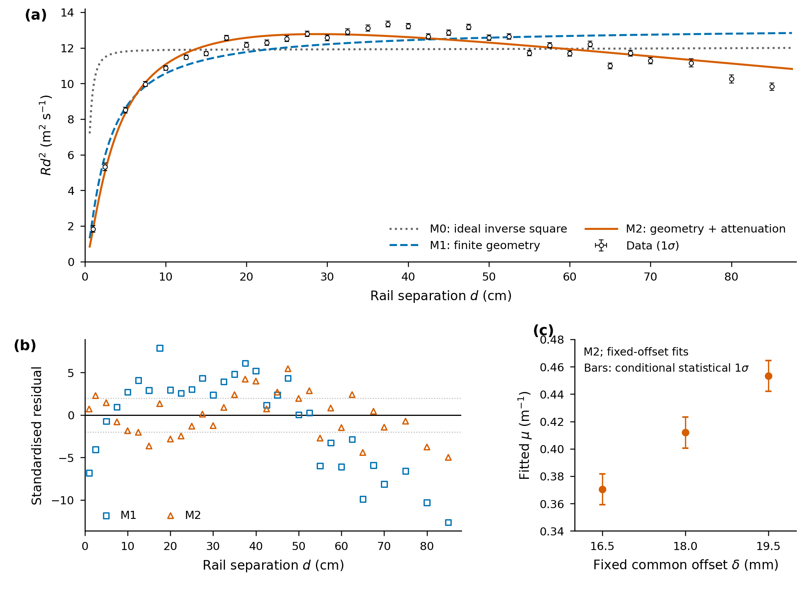

# Sr-90/Y-90 inverse-square analysis

Imperial College London Year 2 radioactivity laboratory project. **Private repository.**

**Research question:** To what extent can realistic source–detector geometry and effective β-particle attenuation explain the observed deviations from the inverse-square law?

A sealed Sr-90/Y-90 source faces a 10 × 10 mm² silicon detector on a rail. A uniform circular emitting disc of radius 4.875 mm and one common active-plane offset of 18.0 ± 1.5 mm are the established geometry assumptions, not adjustable choices made to improve agreement.

## Data and models

`data/raw/Task16_2.csv` is the byte-preserved original scan: 32 distances from 1 to 85 cm, counts `n`, exposure `t` (s), distance `d` and reading standard uncertainty `d_unc` (m). Derived spreadsheet columns are retained but not fitted. `deadtime.csv` is the original 500-bin interval histogram. The background control is 8 counts in 60 s.

For latent true rail distance x and physical source contribution S:

| Model | Physical prediction | Added assumption |
|---|---|---|
| M0 | S = K/x² | Ideal source and small-detector inverse square |
| M1 | S = C G(x;δ) | Shared offset, finite circular source and rectangular-detector solid angle |
| M2 | S = C G(x;δ) exp(−μx) | Phenomenological effective attenuation |

G averages the analytic rectangular-detector solid angle over the source disc, using validated 24 radial × 96 angular quadrature. All three models use **the same measurement response**:

R = (S+B) / [1+τ(S+B)], with B = β/(1−τβ).

β is one observed background rate jointly fitted to the scan and its Poisson control; τ = 1.97884 µs is fixed. Its ±0.02126 µs sensitivity is separate. μ is an effective distance-dependence parameter, **not a measured physical air absorption coefficient**. C incorporates source emission and detector response, not a calibrated activity.

## Results

| Model | Scan Poisson deviance | Total deviance | Nominal dof | Total/dof | Reduction from previous |
|---|---:|---:|---:|---:|---:|
| M0 | 772.663 | 2785.110 | 31 | 89.84 | — |
| M1 | 851.941 | 1022.790 | 31 | 32.99 | 63.28% |
| M2 | 190.912 | 216.605 | 30 | 7.22 | 78.82% |

M0 was refitted with background and dead time: its total is **not** the historical 2894.535. Total deviance adds background-control deviance, individual distance penalties and (for M1/M2) the shared offset penalty to the scan term. M0→M1 actually increases the scan counting term while greatly reducing the distance penalty; the total is the comparable objective.

M2 gives μ = 0.440778 ± 0.015888 m⁻¹ (formal local 1σ, τ fixed, background and shared offset profiled). Its ΔD=1 profile interval is 0.425031–0.456552 m⁻¹. The fitted offset is 19.0446 ± 0.4017 mm under the same conditional model. These intervals exclude model inadequacy.

Fixed-offset M2 scenarios give μ = 0.370450, 0.411925 and 0.453350 m⁻¹ at δ = 16.5, 18.0 and 19.5 mm. Their approximately 0.01132 m⁻¹ error bars are conditional statistical uncertainties; the scenario span is **not a confidence interval**. The point-source/small-detector approximations P1/P2 are retained only as geometry sensitivity checks. See [quantitative interpretation](docs/results.md).



The [vector PDF](results/figures/final_three_panel.pdf) is designed at 178 × 130 mm for a full-width `figure*` in a two-column A4 report. The PNG is 300 dpi. Use this width rather than shrinking to one column; body labels are 7–8 pt. [Caption and insertion code](docs/figure_usage.tex) define the residuals and sensitivity bars.

## Statistics and limitations

Scan counts and the background control use Poisson likelihoods. Each latent distance has its own Gaussian reading constraint. M1/M2 use **one shared** Gaussian offset prior, 18.0 ± 1.5 mm, preserving the induced correlations. Formal errors use the unrescaled local likelihood curvature. [Methods](docs/methodology.md) explain the component deviances, nuisance parameters, nominal degrees of freedom, residuals and numerical checks.

All three models have substantial lack of fit. M2 retains structured residuals, including positive middle-distance departures and negative terminal departures. Model improvement does not identify a unique physical mechanism. Alignment, aperture/encapsulation, beta energy dependence, detector threshold, background drift and repeat variability remain uncharacterised. The non-paralysable response and Poisson count law are working approximations; a true dead-time process need not be Poisson. Formal p-values are only nominal diagnostics.

The available histogram recovery fit gives about 1.998734 ± 0.020807 µs, whereas the prescribed scan constant remains 1.97884 ± 0.02126 µs; its exact derivation was not found locally. The 31.25 µs histogram range and final-bin overflow convention are assumptions not documented by the CSV itself. No value was changed to obtain a better fit.

## Reproduce

Python 3.11+; verified using Python 3.13.5 and the pinned packages:

```sh
python -m venv .venv
source .venv/bin/activate
python -m pip install -r requirements.txt
python reproduce.py
```

The entry point also works from another current directory when invoked by absolute path. It regenerates all current tables, the three-panel PDF/PNG and the histogram diagnostic; it verifies immutable raw hashes, geometry quadrature, component sums, analytic Jacobians, alternate starting values and sensitivity results. No external data, network or Geant4 is needed. `src/plotting.py` provides the final figure; `src/comparison.py` orchestrates the fits.

## Layout and history

```text
data/raw/       immutable original CSV files
src/            geometry, common-response models, comparison, plotting, timing
results/        current figures and numerical tables
report/         preserved historical two-page LaTeX report and assets
docs/           methods, interpretation, caption, verification and provenance
archive/        complete historical M0–M3 scripts, outputs and documentation
reproduce.py    supported current analysis entry point
```

Historical M0–M3 labels differ from current M0–M2. They are preserved under `archive/2026-11-03_M0-M3/`, and must not be mixed with current tables. The unmodified `report/` predates both final model sequences and uses different geometry/transport assumptions; it is **historical**, not a report of the current results. Build it with `cd report && pdflatex main.tex && pdflatex main.tex`. Its archived figures are not regenerated by this pipeline.
